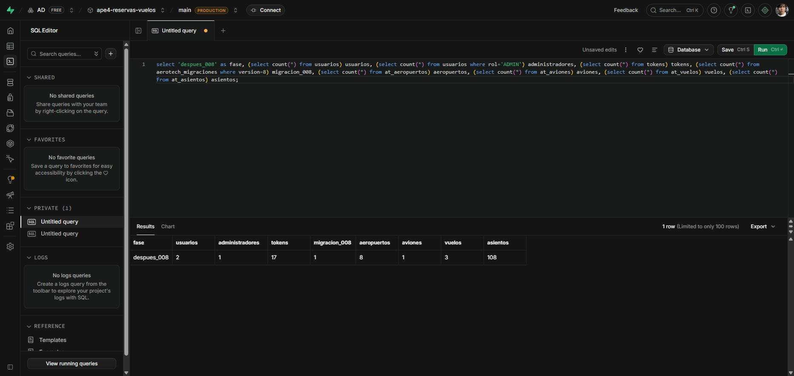

# Acta de ejecución observada — AeroTech APE4

Fecha: 17 de noviembre de 2026. Todas las operaciones financieras corresponden a **Stripe TEST**, no a dinero real.

## Entornos y alcance

| Entorno | Uso observado |
|---|---|
| Flutter Web local | Cliente real contra API Render; pantallas de registro, login, vuelos, mapa y cabina |
| Render | Servicio `adape4-reservas-vuelos-api`; primera revisión `8c4aa6a`, corrección de versión API en rama de entrega |
| Supabase APE4 | Migración 008 aplicada una vez; usuarios y administrador conservados |
| PostgreSQL 17 aislado | Pruebas funcionales, carreras reales y capturas ADMIN; no es la base remota |
| Stripe SDK + servidor HTTP local | Fallos de transporte después de escritura, idempotencia y HMAC; no equivale a pago integrado |

## Resultados automatizados observados

| Comando | Resultado final |
|---|---|
| `python -m pytest backend/tests -q --tb=short` con `AEROTECH_TEST_DSN` de PostgreSQL local | **123 aprobadas**, 93,56 s; incluye SQL real y SDK HTTP simulado |
| `flutter test --no-pub --reporter compact` | **141 aprobadas** |
| `flutter analyze --no-pub` | **Sin incidencias** |
| `python -m pytest backend/tests/test_stripe_sdk_simulacion.py -q` | 9 aprobadas en la comprobación final del padre; regresiones de versión y forma real de Refund incluidas |
| Carga de esquema nuevo, sonda SQL transaccional y `compileall` | Salida 0 |
| Sondas independientes SQL/HTTP | Sin bloqueos reproducidos; un ganador para el mismo asiento, propiedad, reembolsos exactos, recuperación de incertidumbre y rechazo de sesión ajena |

La primera suite Flutter detectó una expectativa antigua de texto: 139 aprobadas y una fallida. Se actualizó la expectativa a «Vuelo con reservas»; la repetición completa aprobó las 140. Esto no se oculta como si la primera ejecución hubiera sido correcta.

## Reinicio autorizado de la aplicación

| Medición Supabase | Antes de 008 | Después de 008 |
|---|---:|---:|
| Usuarios existentes | 2 | 2 |
| Administradores | 1 | 1 |
| Tokens existentes | 17 | 17 |
| Vuelos/reservas del dominio antiguo | 5 / 6 | Eliminados por autorización |
| Aeropuertos / aviones / vuelos nuevos | No existían | 8 / 1 / 3 |
| Asientos numerados | No existían | 108: 36 por vuelo |

La guardia de repetición se comprobó en PostgreSQL aislado; **no** se repitió el borrado remoto para fabricar una captura. Después se registró una cuenta USER sintética para el recorrido integrado; no se alteró el rol de la cuenta real del usuario.

## Comprobaciones HTTP de Render

- `GET /api/sistema/vuelos`: HTTP 200, tres vuelos.
- `GET /api/sistema/pedidos` sin JWT: HTTP 401, código `autenticacion_requerida`.
- Registro e inicio de sesión desde Flutter contra Render: cuenta sintética USER accede a vuelos y cabina.

## Incidencia real detectada al integrar Stripe

El primer intento Checkout obtuvo HTTP 400 del proveedor: la API `2026-10-28.endive`, predeterminada en SDK 17, retiró `payment_method_types`. La retención permaneció segura y no se emitió una reserva ni se inventó un pago.

Corrección: fijar explícitamente `2026-05-27.dahlia`, igual que el webhook, manteniendo tarjeta, importes, metadatos, cuerpo y clave idempotente. La regresión observó primero el encabezado incorrecto (RED) y después el correcto (GREEN). Una sonda independiente confirmó el encabezado y la preservación de cuerpo/clave/sesión.

**Resultado financiero integrado:** completado contra el proveedor real TEST, con detalle en «Cierre observado de la integración». La simulación y el retorno del navegador no se utilizaron como prueba suficiente.

## Capturas reales disponibles

Las capturas ADMIN con sufijo `local-aislado` se tomaron en una base reconstruible con una cuenta ficticia; no demuestran por sí solas administración en Supabase. Las demás pantallas de la aplicación se conectaron a Render.

- A01: diagrama de diseño, no captura de ejecución.
- P00: landing.
- P01: formulario de registro real.
- P02: formulario de acceso real.
- P03: catálogos ADMIN, entorno local aislado.
- P04: listado y mapa nacional, más conteos de migración.
- P05: selección de 1A y 3A de clases distintas.
- P15: despliegue Render de la primera revisión.

Los archivos financieros y XML fueron agregados después de observar sus resultados reales; consulte la galería.

## Seguimiento de incidencias TEST

- La versión API fijada se desplegó y un pedido distinto de AT102 creó Checkout y cobró **USD 205,85** en TEST: 1A Ejecutiva (USD 138,00 con IVA) y 3A Económica (USD 67,85 con IVA). Flutter confirmó «Pago confirmado · reserva emitida»; se obtuvo XML real.
- El pedido fallido anterior de AT101 mantuvo el HTTP 400 original, con `Idempotent-Replayed: true`, incluso bajo el encabezado corregido. No se cambió su clave para forzar otro cobro. Tras verificar que Stripe rechazó la creación antes de generar sesión/objeto y que no había pago ni reserva, se cerró **solo ese pedido de prueba** mediante transacción condicionada y bloqueo del mismo dominio. Se conservó el registro y la explicación; no se repitió la migración ni se atribuyó una expiración inexistente al proveedor.
- El reembolso parcial de 3A obtuvo HTTP 200 y `succeeded` por USD 67,85 en Stripe TEST. La app detectó un fallo de compatibilidad: el objeto Refund real no incluye `livemode`; su verificación inicial esperaba ese campo. El asiento permanece retenido mientras se corrige la comprobación. No se ha enviado otra devolución con otra clave.
- Corrección en curso: demostrar modo TEST mediante Checkout original recuperado y vinculado, conservando todas las comprobaciones de importe, moneda, propietario, sesión, PaymentIntent y metadatos. Se reintentará la cancelación existente para recuperar el mismo reembolso, no para emitir uno nuevo.

## Cierre observado de la integración

A las 21:49 UTC del 17/11/2026, con código de servicio `312a7df`:

- La cancelación parcial existente recuperó **el mismo** reembolso de 6.785 centavos: 3A cancelado, 1A activo, total original 20.585, devuelto 6.785, restante 13.800. No se creó otra operación monetaria para superar el error.
- Después se canceló el único asiento restante, 1A, por 13.800 centavos. La reserva quedó cancelada, cero activos y dos cancelados; total devuelto **20.585**, exactamente el importe original.
- Supabase confirmó **dos devoluciones**, no tres; los tres vuelos quedaron con **36 asientos libres cada uno**. Se preservaron los importes e historial. El vuelo de la prueba quedó libre para la práctica del usuario.
- El pedido independiente de AT103 se abandonó sin pagar: Checkout expirado por proveedor y asiento liberado.
- Eventos firmados persistidos: `checkout.session.completed` (1), `checkout.session.expired` (1), `refund.created` (1) y `refund.updated` (1) al tomar la evidencia. La llegada posterior de eventos puede aumentar esos conteos sin duplicar reservas/devoluciones.
- Suite final backend: **123 aprobadas**, 93,56 s. Comprobación del padre SDK HTTP: **9 aprobadas**, 17,07 s. Flutter: **141 aprobadas**; análisis sin incidencias; prueba focal posterior a normalización: cuatro aprobadas.
- Se corrigió además la actualización del listado al regresar desde reservas: prueba RED obtuvo una consulta en lugar de dos; GREEN recarga disponibilidad conservando el JWT.

### Límites de la evidencia

No se ensayó Android/iOS físico ni una operación con dinero real. La concurrencia simultánea se probó en PostgreSQL local mediante conexiones reales, no con dos compradores remotos. Las pruebas de firmas inválidas, inyección de fallos y límites exhaustivos son automatizadas/aisladas. No se ejecutó manualmente una tarjeta rechazada remota; sí abandono sin pago y errores reales de creación. Las capturas ADMIN son locales y están identificadas. Los nombres de estudiantes/firmas institucionales deben completarse por el grupo.

Los cambios de documentación posteriores al servicio `312a7df` consolidan los resultados observados; no deben interpretarse como una nueva operación financiera.
