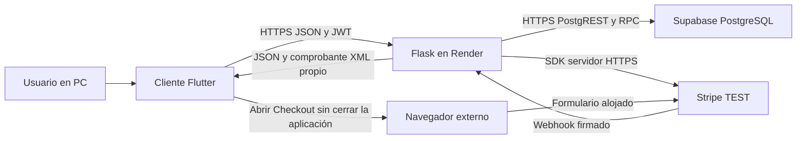
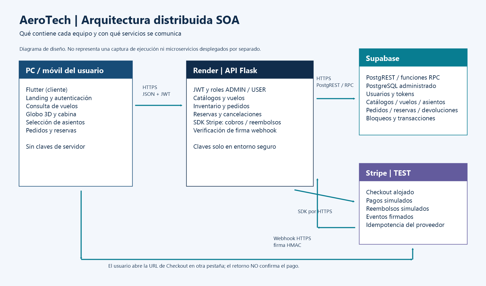
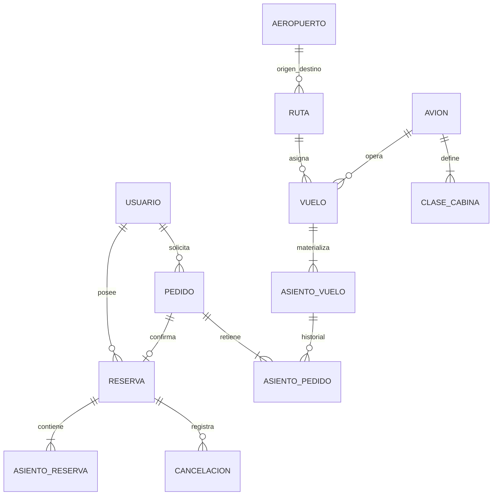
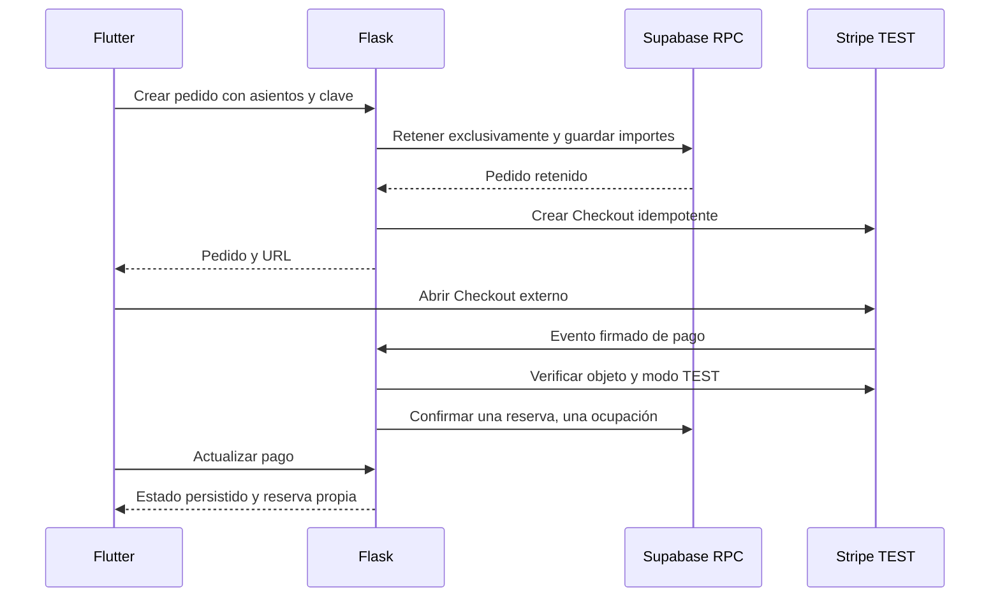

# Arquitectura SOA de AeroTech

AeroTech separa identidad, catálogos, inventario, pagos y reservas mediante contratos REST. La distribución física ocurre entre el cliente, el backend y proveedores administrados. Los módulos de Flask comparten despliegue: **SOA no implica afirmar microservicios independientes**.

**Estado:** diseño alineado con `CONTRATO_SISTEMA.md`; la existencia y configuración de cada despliegue se acredita mediante P01-P14, no mediante este diagrama.

## 1. Contexto y topología

```text
PC del usuario
  Flutter: formularios, mapa, cabina, pedidos y reservas
      | HTTPS + JSON / JWT Bearer
      v
Render: API Flask
  Identidad | Catálogos | Vuelos | Pedidos | Reservas
      |                                  |
      | HTTPS: PostgREST / RPC             | SDK servidor por HTTPS
      v                                  v
Supabase                            Stripe TEST
  API de datos -> PostgreSQL        Checkout / pagos / reembolsos
                                         |
Navegador externo <--- Checkout URL ------+
                                         |
Flask <------ HTTPS: webhook firmado -----+
```





**Figura A01:** componentes y conexiones del sistema. PNG preparado para insertar en Word; es un diagrama de diseño, no una captura de ejecución. El bloque Mermaid conserva la fuente editable.

No hay credenciales Supabase privilegiadas ni clave secreta Stripe en Flutter. El backend no utiliza una conexión PostgreSQL directa en esta topología: invoca la API HTTP de Supabase y sus funciones RPC. PostgREST expone la persistencia; PostgreSQL ejecuta las garantías transaccionales. Esta distinción debe conservarse en el informe de despliegue. [Referencia Supabase](https://supabase.com/docs/guides/api).

## 2. Actores y límites de confianza

| Actor o componente | Responsabilidad | Lo que no decide |
|---|---|---|
| Visitante | Registro e inicio de sesión | Roles y autenticidad de pagos |
| USER | Consultar vuelos; adquirir y gestionar sus reservas | Reservas ajenas, tarifas o stock |
| ADMIN | Gestionar catálogos, vuelos y roles autorizados | Liberar asientos comprometidos o alterar importes pagados |
| Flutter | Presentación, selección y solicitudes HTTP | Usuario propietario, precio final, privilegios |
| Flask | JWT, roles, validación de negocio y coordinación | Inventar éxito cuando un proveedor no responde |
| Supabase/PostgreSQL | Datos, exclusión y operaciones atómicas | Confirmar un pago sin evidencia del proveedor |
| Stripe TEST | Estado de Checkout, cobro y devolución simulados | Autorización de acceso a reservas AeroTech |

El JWT existente se mantiene en memoria de la aplicación. No se agrega confirmación por correo ni un segundo factor propio. Esto no elimina la autorización por rol ni sustituye la autenticación 3D Secure que Stripe pueda requerir.

## 3. Servicios y contratos

| Servicio lógico | Operaciones del nuevo dominio | Consumidor |
|---|---|---|
| Catálogos | GET/POST aeropuertos, aviones, rutas; PUT/DELETE por ID y versión | UI administrativa y consulta |
| Vuelos | GET/POST vuelos; PUT/DELETE por ID y versión; GET cabina | ADMIN y cliente |
| Pedidos | POST pedido; GET pedidos propios/detalle; POST abandono | Cliente autenticado |
| Reservas | GET propias/detalle/XML; POST cancelaciones/reintento | Propietario |
| Integración Stripe | POST webhook; GET retorno informativo | Stripe y navegador |

Prefijo de negocio: `/api/sistema`. Webhook: `/api/stripe/webhook`. Retorno: `/api/stripe/retorno`. El contrato completo evita duplicar reglas o renombrar campos: [CONTRATO_SISTEMA.md](CONTRATO_SISTEMA.md).

El módulo existente conserva los siguientes contratos verificados en código por la integración:

| Operación | Endpoint | Acceso |
|---|---|---|
| Registro | `POST /api/usuarios/registro`, campos `nombre`, `correo`, `contrasena` | Público; no crea ADMIN |
| Inicio de sesión | `POST /api/auth/login` | Público con credenciales válidas |
| Perfil | `GET /api/auth/perfil` | JWT válido |
| Listar usuarios | `GET /api/admin/usuarios` | ADMIN |
| Promover usuario | `POST /api/admin/usuarios/{id}/promover` | ADMIN |

La validación JWT recarga el usuario desde la base de datos y considera su rol vigente. Las respuestas observadas y pruebas de permisos siguen pendientes de P01-P03.

### Ejemplo de intercambio, no resultado observado

```http
POST /api/sistema/pedidos
Authorization: Bearer <JWT omitido>
Content-Type: application/json

{"vuelo_id":"<UUID de prueba>","asientos":["1A"],"clave_operacion":"<UUID único>"}
```

El servidor determina propietario, disponibilidad, tarifa, impuestos y total. Una respuesta 201 contiene `pedido` y `checkout_url`; un conflicto no debe producir un segundo pedido cobrable. Los marcadores anteriores son datos ilustrativos, no credenciales ni evidencia de ejecución.

## 4. Modelo conceptual y persistencia



**Figura A02:** modelo conceptual, no inventario literal de nombres de tablas SQL. La entrega final debe contrastar nombres físicos con la migración aplicada.

| Dato | Invariante |
|---|---|
| Aeropuerto | IATA único, coordenadas válidas y zona horaria IANA |
| Ruta | Dos aeropuertos activos distintos mediante claves foráneas |
| Avión y clases | Filas y columnas sin solapamientos; capacidad derivada |
| Vuelo | Instantes UTC; horas locales interpretadas en cada aeropuerto; no solapar avión |
| Asiento de vuelo | Etiqueta y clase estables; una sola ocupación/retención efectiva |
| Pedido | Propietario servidor; clave idempotente y estado reconciliable |
| Reserva | Snapshot de condiciones e importes originales en centavos |
| Cancelación | Subconjunto válido; suma reembolsada no superior al cargo |
| Evento externo | Deduplicación e identificación del proyecto y objeto propios |

Los asientos no se construyen a partir de una cantidad libre ni se renumeran cuando otros se ocupan. La disponibilidad es derivada; no es un campo editable por ADMIN.

## 5. Flujo de compra

1. Flutter consulta vuelos por aeropuertos y fecha de salida local del origen.
2. Al abrir la cabina, recibe todas las posiciones y su estado, incluso ocupadas.
3. El usuario selecciona asientos y crea un pedido con una clave de operación.
4. Una operación transaccional retiene exclusivamente los asientos; el servidor calcula el desglose original en centavos.
5. Flask crea Checkout TEST y conserva su identificación. Si hay incertidumbre, el pedido queda recuperable; no se simula una compra exitosa.
6. Flutter abre Checkout en otra pestaña o navegador. El retorno informa; no confirma el pago.
7. Webhook firmado o reconciliación servidor verifican sesión, importe, moneda, modo TEST y metadatos propios.
8. La transición idempotente confirma exactamente una reserva y ocupa los asientos.



### Estados esperados del pedido

`preparando_pago -> pendiente_pago -> pagado` es el camino normal. `expirado`, `cancelado` y `revision_pago` describen salidas o incertidumbre. Un reloj local vencido no prueba que Stripe no haya cobrado: antes de liberar un asiento con sesión creada se consulta el estado real. Stripe inaccesible implica conservar el inventario bloqueado y reintentar.

Ante un pago excepcional tardío sin inventario disponible, la solución no emite una reserva inválida: debe abrir recuperación/reembolso del incidente. P10-P11 deben demostrar esos casos.

## 6. Cancelación parcial y dinero

La política académica permite cancelar antes de salida uno o varios asientos activos y devolver el 100 % proporcional sin penalización, exclusivamente en TEST. No representa condiciones fiscales ni comerciales reales.

- Se conserva el desglose original de cada asiento: subtotal, IVA académico del 15 % y total en centavos USD.
- El importe de devolución se suma desde esos valores inmutables; no se recalcula con una tarifa posterior.
- La reserva mantiene cantidades activa/cancelada e historial; no desaparece al cancelar el último asiento.
- `reembolso_pendiente` conserva el bloqueo del asiento hasta confirmación del proveedor.
- Un reintento usa la misma operación y cargo; no emite otra devolución.
- El proveedor puede informar un reembolso pendiente; la aceptación de la solicitud no equivale a devolución finalizada. [Stripe: reembolsos](https://docs.stripe.com/refunds).

## 7. Errores, concurrencia y seguridad

| Riesgo | Respuesta prevista | Prueba |
|---|---|---|
| Dos compradores eligen 1A | Una retención efectiva; el otro recibe conflicto | P05 |
| Doble clic o repetición HTTP | Misma clave/mismo contenido recupera operación; contenido diferente provoca conflicto | P09 |
| Webhook repetido o fuera de orden | Deduplicar; no retroceder una compra pagada ni duplicar reserva/reembolso | P10 |
| Firma falsa o cuerpo modificado | Rechazar antes de procesar el evento | P10 |
| Clave de proveedor ausente | Error recuperable; ningún pago fingido | P11 |
| Timeout al expirar sesión o devolver | Conservar estado seguro e identificadores para reconciliar | P11 |
| Edición de cabina/vuelo ocupado | Rechazar; no invalidar compromisos existentes | P12 |
| Consulta de reserva ajena | Denegar sin exponer contenido ni XML | P14 |

Las firmas de Stripe se verifican con el cuerpo original y `Stripe-Signature`; no con JSON reconstruido. Los eventos solo se admiten para objetos del proyecto propio. El endpoint público requiere HTTPS y secretos solo de servidor. [Documentación de webhooks](https://docs.stripe.com/webhooks).

## 8. Despliegue, configuración y reinicio autorizado

| Elemento | Dato documentable | Evidencia pendiente |
|---|---|---|
| Backend | URL prevista `https://adape4-reservas-vuelos-api.onrender.com` | Respuesta real de la revisión desplegada |
| Supabase | API de datos y RPC del proyecto APE4 | Migración aplicada y transacciones verificadas |
| Stripe | Clave TEST y secreto de webhook configurados solo en servidor | Pago/reembolso TEST y firma real |
| Flutter | Cliente que conserva sesión al abrir Checkout | P06 y captura del regreso a la app |

La URL prevista no certifica que la versión nueva esté publicada. Nunca incluir valores de `STRIPE_SECRET_KEY`, `STRIPE_WEBHOOK_SECRET`, JWT ni credenciales Supabase en el informe.

El usuario autorizó reiniciar los datos para evitar conflictos. El alcance seleccionado es **solo reservas/vuelos anteriores de APE4**, preservando usuarios, roles y acceso existentes. El reinicio debe ser transaccional y contar con guardia de una sola ejecución. No elimina datos de otros proyectos ni objetos Stripe, y no inventa asientos para reservas antiguas. Las rutas de compra antiguas dejan de emitir reservas gratuitas y responden 410 según el contrato.

**PENDIENTE:** registrar migración exacta aplicada, ejecución única y comprobación de usuarios preservados sin publicar identidades privadas. Esta sección documenta la autorización y la restricción; no dice que el borrado se haya ejecutado.

## 9. Alcance y límites

Una sola aerolínea, dos roles existentes y pagos de prueba. No se declara multitenencia, inventario de aerolíneas reales, emisión fiscal, conexión SQL cliente, SLA ni prueba de carga. Para los resultados verificados y sus límites, consultar [PRUEBAS_Y_EVIDENCIAS.md](PRUEBAS_Y_EVIDENCIAS.md).
