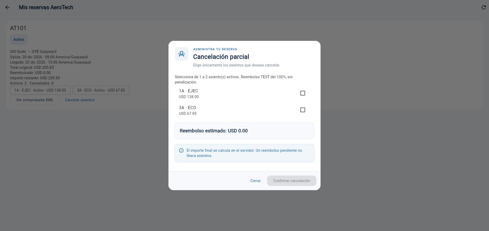
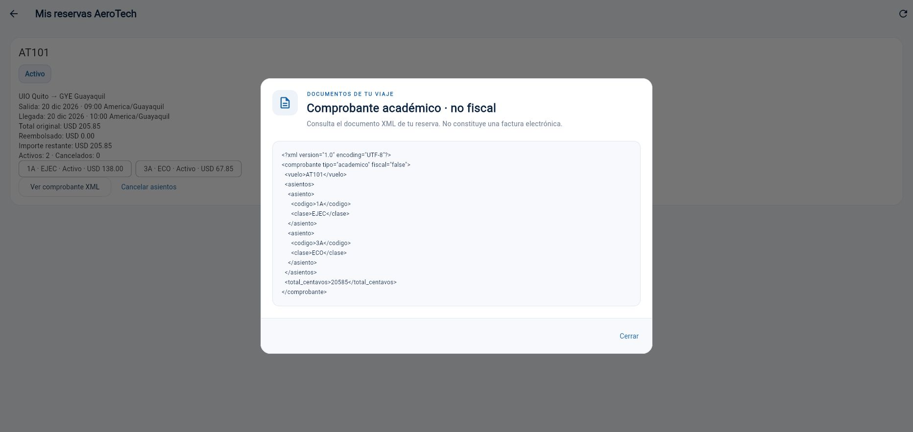
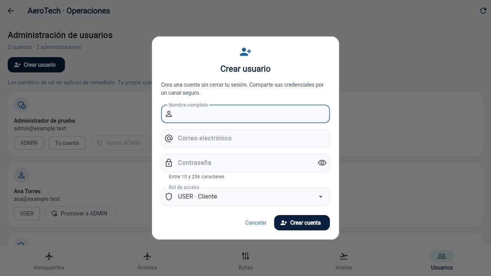
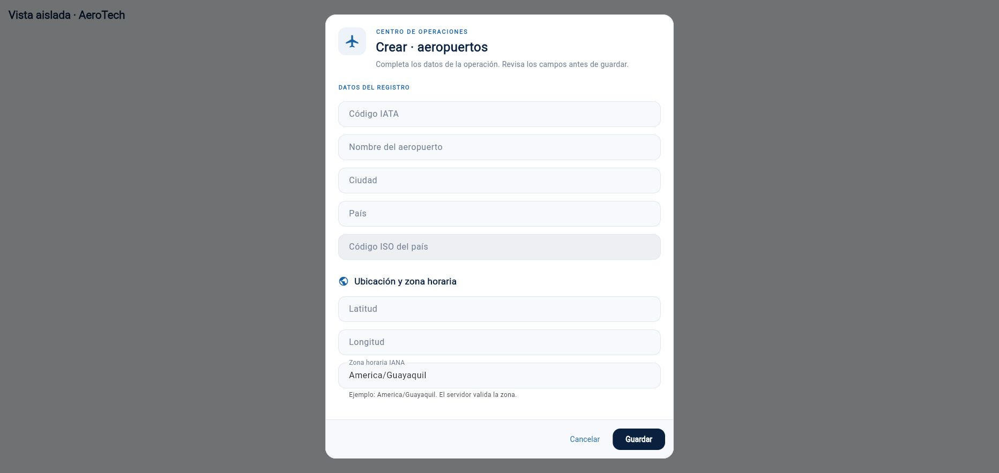
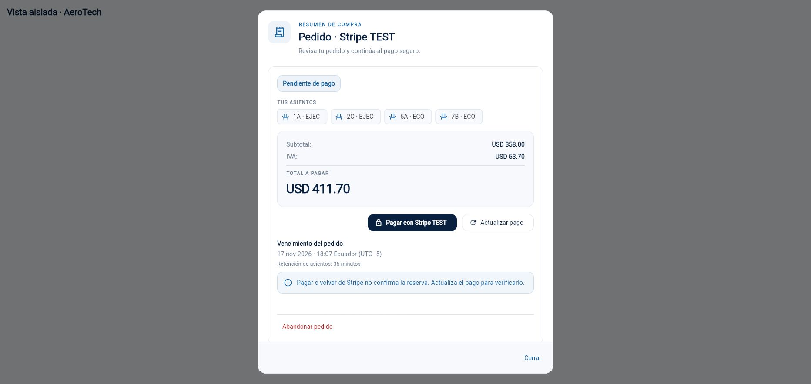
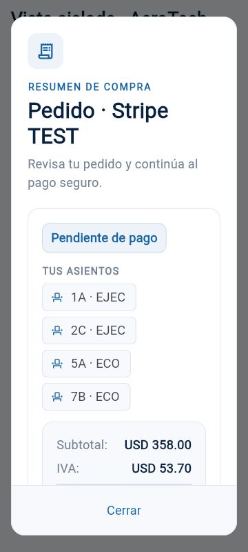
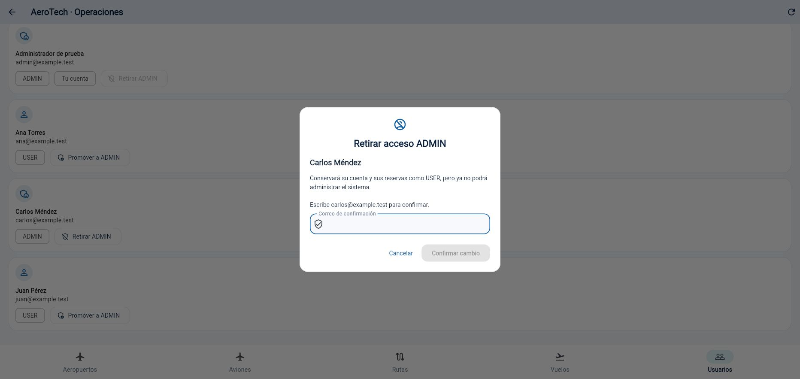
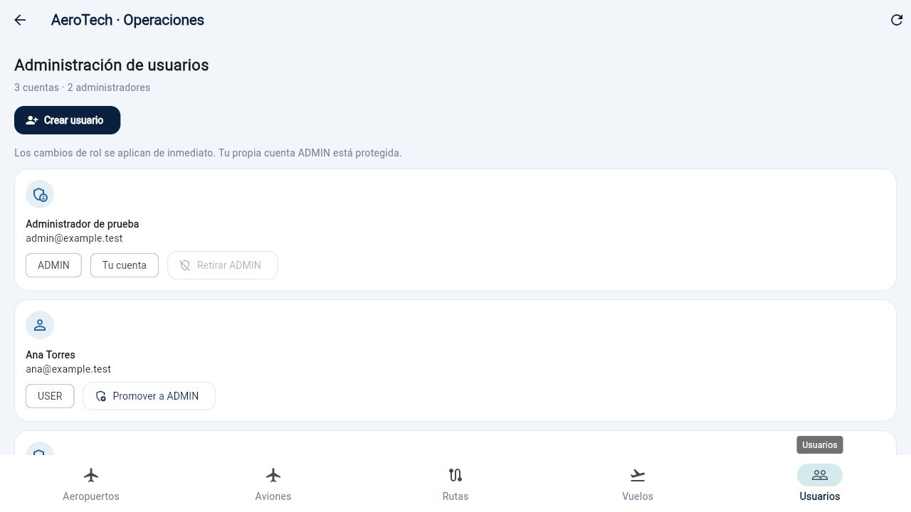

# Mejoras visuales y gestión de usuarios

Se mejoraron pedidos, modales informativos y formularios de AeroTech. También se permite crear usuarios y retirar ADMIN a otra cuenta desde **Operaciones → Usuarios**, sin cerrar la sesión del operador.

## Cambios visibles

- Encabezados compactos, superficies claras, iconos, mensajes y acciones diferenciadas.
- Pedido con estado legible, asientos individuales, total destacado, pago principal visible y vencimiento en Ecuador UTC−5.
- El resumen se abre desde arriba al pasar de cabina a pedido, incluso después de seleccionar filas inferiores.
- Formularios de catálogos organizados por secciones; comprobante XML y cancelación con contexto claro.
- Usuarios con cuentas/roles visibles, alta USER por defecto, autorización explícita para crear ADMIN y confirmación por correo escrito para cambiar un rol.

Crear usuarios no cambia el JWT/perfil del operador. Retirar ADMIN no borra cuentas ni reservas. No se permite retirar el propio ADMIN ni dejar el sistema sin administrador; las reglas se verifican en servidor bajo un bloqueo transaccional común.

Detalles: [presentación](../presentacion-interfaz.md) y [administración segura/API](../usuarios-administracion.md).

## Verificación observada

- Suite backend: **133 aprobadas**, 93,90s, con PostgreSQL17 real aislado.
- Suite Flutter: **153 aprobadas**, análisis sin incidencias.
- Verificador independiente: permisos, datos sin cambios ante rechazos, JWT revocado, doble retiro concurrente, creación duplicada y RPC sin acceso para anon/authenticated. Compatibilidad exacta de promoción antigua verificada después de una corrección.
- Migración009 aplicada de forma aditiva en Supabase APE4:3 cuentas/2ADMIN antes y después, firma conjunta de datos/hashes/roles sin cambios. RPC exclusiva de service_role; no se ejecutaron cambios de rol sobre cuentas reales.
- Revisión visual con **widgets reales y API simulada**, sin conectarse a Render/Supabase/Stripe: alta y retiro de rol simulados, pedido equivalente al ejemplo35800+5370=41170centavos, formularios, XML y cancelación.

El marco móvil muestra layout360×800 y texto1,3; es un marco Flutter de prueba, no un dispositivo físico. Las pruebas automatizadas también cubren320×640 y CTA1280×720. El control de viewport del navegador no alteró sus medidas; fue restablecido y no se presenta como evidencia de emulación nativa.

## Capturas de la revisión visual aislada

### cancelacion informativa

### comprobante xml

### crear usuario escritorio

### formulario operativo

### pedido escritorio

### pedido marco movil 360

### retirar admin confirmacion

### usuarios escritorio

